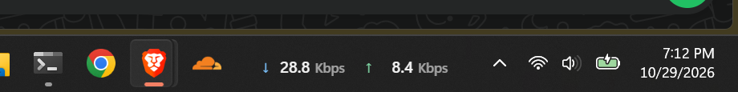
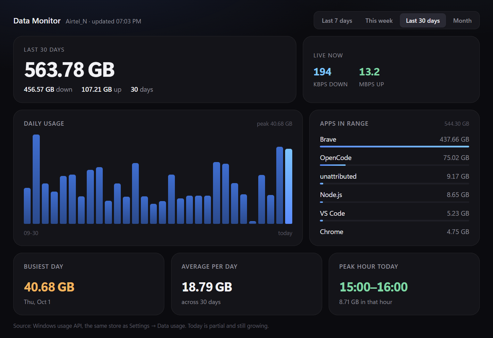
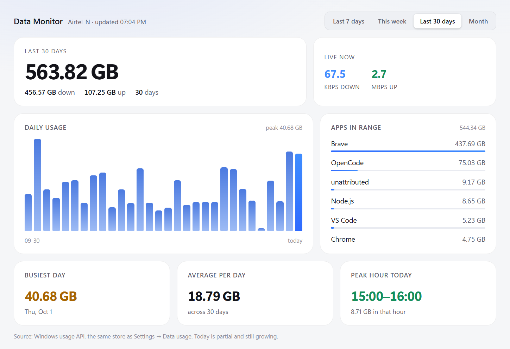

# Data Monitor

A local-only network monitor for Windows that lives in your taskbar. It shows live
throughput in bits per second, and answers the question the Task Manager can't:
*where did today's data go?*



Nothing leaves the machine. No account, no sync, no telemetry — the app talks to
Windows, and to nothing else.

**Listen:** [narration.wav](narration.wav) (2 min 48 s) · **script:** [narration.md](narration.md)

---

## The three surfaces

**The widget** is the whole point. A 210 × 34 DIP strip pinned into the taskbar,
showing `↓ 240 Kbps  ↑ 36.9 Mbps`. No click to open, no window to find. It is
click-through-free, never focusable, and disappears the moment the taskbar hides.

**The dashboard** opens when you click the readout. Four ranges — last 7 days, this
week, last 30 days, or a specific month — a daily chart, a per-app ranking, and the
busiest day, average, and peak hour.



**The popover** appears when you hover the readout: today's total, the down/up split,
and the top three apps. It is the "should I care?" answer without opening anything.

The **tray icon** carries the controls: open the dashboard, pause collection, switch
theme, quit.

---

## Architecture

```text
┌─────────────────────────────── Windows 11 ───────────────────────────────┐
│  Explorer taskbar (a XAML island — child windows do not render)          │
│                                                                          │
│   ┌──────────────────┐                                                   │
│   │  Widget overlay  │   topmost, no-activate, tool window, 210×34 DIP   │
│   └────────┬─────────┘                                                   │
│            │ click                          hover                        │
│   ┌────────▼─────────┐            ┌──────────────────────┐               │
│   │ Dashboard window │            │ Popover window       │               │
│   └────────┬─────────┘            └──────────┬───────────┘               │
└────────────┼─────────────────────────────────┼───────────────────────────┘
             │ IPC                             │ IPC
┌────────────▼─────────────────────────────────▼───────────────────────────┐
│ Electron main process                                                    │
│   • geometry: Shell_TrayWnd / Start / TrayNotifyWnd rects                │
│   • 150 ms reposition loop · 500 ms topmost re-raise                     │
│   • visibility: bar rect + SHQueryUserNotificationState                  │
│   • theme via nativeTheme · settings.json                                │
│   • IPC: open-dashboard, request-usage, set-theme, hover                 │
└──────────┬───────────────────────────────────┬───────────────────────────┘
           │ child_process                     │ child_process
┌──────────▼─────────────────┐      ┌──────────▼──────────────────────────┐
│ sampler.ps1                │      │ usage.ps1                           │
│ Get-NetAdapterStatistics   │      │ WinRT GetNetworkUsageAsync          │
│ once a second → bytes/s    │      │ GetAttributedNetworkUsageAsync      │
│ EMA smoothing → Kbps/Mbps  │      │ per-day · per-hour · per-app        │
└────────────────────────────┘      └─────────────────────────────────────┘
```

### Why the widget is an overlay, not an embedded window

On Windows 11 build 26300 the taskbar is a XAML island. A window parented into
`Shell_TrayWnd` reports `IsWindowVisible() == true` and paints nothing — measured with a
probe window that rendered pure magenta as a normal window and was invisible as a child.
`MSTaskListWClass` is a hollow shell. So the readout is a **topmost overlay** positioned
over the bar's rect: visually indistinguishable from an embedded widget, and it survives
Explorer restarts because it was never a child.

Two consequences the code handles:

- The taskbar is itself topmost and re-raises after notifications and clock ticks, so the
  overlay re-asserts its place every 500 ms.
- The icon row is drawn by XAML, so its real width cannot be measured. The widget sits in
  the empty band left of the centred Start button instead of beside the clock, where it
  would overlap icons as soon as enough apps are open.

### When it is visible

Two independent signals, because either one alone lies:

| Signal | Says |
|---|---|
| `Shell_TrayWnd` rect top | `1128` when revealed, `1198` when auto-hidden |
| `SHQueryUserNotificationState` | `2`/`3`/`4` when a fullscreen app or presentation owns the display — the bar keeps its normal rect but is not drawn |

The widget shows only when the bar is revealed **and** no fullscreen app is running.

---

## Where the numbers come from

**Live speed** is the physical Wi-Fi adapter's byte counters, sampled once a second and
converted to bits per second. Counters that go backwards (adapter reconnect) reset the
baseline instead of producing a negative spike. The display smooths over two samples
because the counters only move at ~1 Hz.

**History** is Windows' own usage store, read unelevated through the WinRT network-usage
API — the same data behind Settings → Data usage. One call gives per-day buckets, one
gives per-hour buckets for today, and one per range gives per-app totals. Bucket start
times are anchored to the window start, because PowerShell cannot project `StartTime`
from the WinRT object; the bucket index plus the anchor is enough.

Per-app rows carry `AttributionId`, not `AppName` — a device path such as
`\device\harddiskvolume3\program files\bravesoftware\brave.exe`, which the app maps to a
readable name and groups by app rather than by process.

Units are adaptive: `Kbps` below 1 Mbps, `Mbps` above, one decimal below 100. The taskbar
readout is deliberately narrow and numeric; the dashboard does the explaining.

---

## Ranges

| Range | Window |
|---|---|
| Last 7 days | the last seven day buckets |
| This week | Monday through today |
| Last 30 days | the last thirty day buckets |
| Month | a calendar month chosen from the picker |

The per-app query is scoped to the visible range, so the Apps card always agrees with the
chart above it. Days the collector did not observe are drawn as unknown, not as zero.

---

## Theme

Dark and light are both first-class, not an inverted afterthought:

| | Dark | Light |
|---|---|---|
| Surface | `#0b0b0f` with a faint blue wash | `#f5f6f8` |
| Card | `#141419` | `#ffffff` |
| Down | `#7cc4ff` | `#1f6feb` |
| Up | `#7fd6a4` | `#148f5b` |
| Peak hour | green | green |
| Busiest day | amber | amber |

The dashboard header has a sun/moon toggle; the tray has Theme → Match Windows / Dark /
Light. The choice is written to `%APPDATA%\taskbar-data-monitor\settings.json` and drives
the dashboard, the widget and the popover together, because all three read the same
`prefers-color-scheme` that `nativeTheme` controls.



---

## Files

```text
app/
  main.js        window lifecycle, geometry loop, theme, IPC
  taskbar.js     Win32 geometry + fullscreen state (koffi)
  sampler.js     adapter counter stream → smoothed bytes/s
  sampler.ps1    Get-NetAdapterStatistics, once a second
  usage.js       runs usage.ps1, caches results for 30 s
  usage.ps1      WinRT per-day / per-hour / per-app query
  format.js      bytes/s → Kbps / Mbps display
  preload.js     the only bridge between main and the three renderers
  widget.html    the taskbar readout
  dashboard.html the full window
  popover.html   the hover summary
  assets/tray.png
docs/              this document and its screenshots
.scratch/          local planning notes (not published)
```

## Running it

```powershell
cd app
npm start
```

It auto-starts at login from a Startup shortcut. Uninstall is: quit from the tray, delete
the shortcut, delete the folder.

## Limits, stated honestly

- The sampler is a **stand-in**: a long-lived PowerShell process costing ~128 MB RSS. The
  planned collector is a small elevated C# helper with an ETW session, which is what makes
  *live* per-app attribution possible. Today's per-app numbers are Windows' per-day
  aggregates, not a live feed.
- No database yet. History is re-read from Windows each time, cached for 30 seconds. The
  collector ticket introduces SQLite, 90-day detail retention and permanent daily and
  monthly rollups.
- No installer yet. The Startup shortcut is a development convenience; the packaging ticket
  replaces it with a per-user NSIS installer and a scheduled task for the collector.
- Primary display only.
